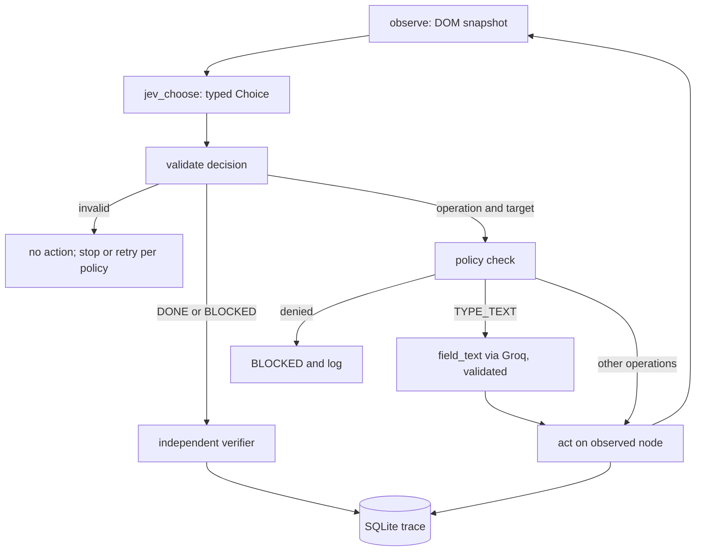

# TypedBrowse Development Context

**Status:** Draft v0.1, 2026-09-24. Consolidated from six uploaded files plus a few spot checks made on 2026-09-24.
**No repository, package, command, directory, or test is verified to exist.** Anything called "proposed" is a plan, not a fact.
**Roles:** Claude (chat) mentors and reviews. Claude Code implements. The owner is a solo developer (personal details intentionally omitted).
**Precedence when sources disagree:** `project-context.md` (PC) > owner decisions of 2026-09-24 > checks made on 2026-09-24 > generic manuals > playbooks.

---

## 0. How to read this document

### 0.1 Status labels

| Label | Meaning |
|---|---|
| **Verified** | Backed by evidence named in the Basis column. |
| **Assumption** | A chosen default. The owner can override it. |
| **Open decision** | Needs an owner decision before dependent work starts. |
| **Recommended improvement** | A suggestion. Not required unless stated. |
| **Unknown** | Not verified. Do not write code against it. |

### 0.2 Basis codes (used in the Basis column)

| Code | Meaning |
|---|---|
| PC | Stated as verified in `project-context.md`. Not independently re-checked. "Verified (PC)" is a weaker claim than "Verified (CHK)". |
| CHK | Checked by Claude on 2026-09-24 by web search. Secondary or third-party sources unless stated. TypeSafe's own docs were not fetched. |
| APPR | Decision given by the owner on 2026-09-24. |
| MAN | From a generic manual. Not re-checked. |

---

## 1. Product

### 1.1 What TypedBrowse is
TypedBrowse is a portfolio browser agent that treats each page as a multiple-choice test. Each step it reads the live page into an indexed table of visible controls and asks Jev (TypeSafe's typed-decision model) to choose the next operation and its target. Code then executes that choice against the observed DOM node. A small Groq model writes text only when the chosen operation is `TYPE_TEXT`. A separate verifier, independent of Jev's DONE, decides whether the goal was reached.

### 1.2 Scope of v0.1 (Assumption, from PC §19 and APPR)
- Playwright Chromium, Jev decisions, Groq text helper, FastAPI inspector, SQLite traces.
- Verifiers for Wikipedia, a local hotel fixture, and Flights (best-effort, opt-in).
- At least 20 eval cases (PC lists 22), keyless replay mode, safety fixtures, deterministic label blocklist.
- Ablation flag (Groq as controller) only if time allows.

### 1.3 Non-goals (PC §1, §19; APPR)
Booking, payment, logins, CAPTCHA, multi-tab, vision models, LLM tool-calling, multi-agent designs, cloud multi-user, an MCP server, copying the Browser Use UI, a live Flights dependency in the primary demo, and any public browsing proxy.

### 1.4 Users (PC §3.2, adapted)
The developer running the loop locally; a portfolio visitor replaying a recorded run without API keys; an evaluator comparing traces and verifier results.

### 1.5 Attribution and legal stance (Verified, PC §1)
- The upstream project, Browser Use's `jev-ultrafast`, is MIT licensed. Its pattern may be reimplemented in original code.
- Attribute Browser Use and TypeSafe in the README and a NOTICE file. State "inspired by, not affiliated".
- Do not fork and rename. Do not copy `snapshot.js`, inspector CSS, banner, demo video, or measurement JSON.
- Do not use "Jev Ultrafast", "Browser Use", or their trademarks as the product name.
- Jev question wording is original TypedBrowse wording (APPR). Exact NOTICE text and our own license are still open (see §6).

---

## 2. Fact register

### 2.1 Upstream behaviour reported in project context
"Verified" here means PC reports it as verified from upstream code or docs. Items marked (summarizer) came from summarized extractions of upstream files, which PC rates High-Medium.

| ID | Statement | Label | Basis |
|---|---|---|---|
| F01 | Pattern: indexed table of visible controls, then one Jev request holding an operation Choice plus speculative target Choices, then execution on the observed node, Groq text only for TYPE_TEXT, then independent verification. | Verified | PC §1 |
| F02 | Upstream operations offered to Jev: CLICK, TYPE_TEXT, SELECT, SCROLL_UP, SCROLL_DOWN, WAIT, DONE, BLOCKED. | Verified | PC §3.5 |
| F03 | Model output never becomes executable: no model-written selectors, coordinates, or JavaScript. | Verified | PC §1, §3 |
| F04 | The default loop sends no screenshots to Jev. | Verified | PC §3.4 |
| F05 | Stop and error behaviour upstream: stale page means re-observe and drop the decision; invalid Jev response means no action; missing text on a fill is an error; three consecutive non-wait actions with no page change means blocked. | Verified | PC §3.7 |
| F06 | Upstream budgets: `MAX_STEPS = 60` actions; model-call budget of twice that. Statuses: ready, predicted, done, blocked. | Verified | PC §3.7 |
| F07 | Upstream memory: last 10 actions to Jev, last 6 to the text helper. No long-term memory. | Verified | PC §6.5 |
| F08 | Upstream retries: 3 attempts, backoff `0.5 * 2^attempt` on 429/529/503, 25 s HTTP timeout. | Verified | PC §6.6 |
| F09 | Upstream Choice validation: chosen id is allowed; probability keys equal the ids; values finite in [0,1]; sum within 0.02 of 1; chosen option has the maximum probability. | Verified | PC §7.5 |
| F10 | Upstream snapshot: up to 250 indexed actions, 6,000 characters of visible text, a fingerprint; password, file, and hidden inputs omitted. | Verified | PC §3, §9 (summarizer) |
| F11 | Upstream has no database, no auth, no queue, no LLM tool-calling, and no MCP in the loop. Traces are JSON files. | Verified | PC §5.1, §9, §10 |
| F12 | Upstream confidence is logged, not thresholded. | Verified | PC §6.7 |
| F13 | Upstream evidence is small-sample. The upstream author has said Jev is weak on long-horizon tasks, so goals must stay short and well-scoped. | Verified | PC §15 |
| F14 | Reported upstream timings (for example Flights 7.073 s, 17 Jev calls, median Jev latency 178 ms, 2 text calls) come from upstream's own docs. They are not our measurements. | Verified | PC §2 |
| F15 | Upstream original state keys: browser, goal, page, decision, history, status, plan, plan_index, decisions, text_calls, elapsed_ms, started_at, record. | Verified | PC §6.2 |

### 2.2 Jev facts and unknowns

| ID | Statement | Label | Basis |
|---|---|---|---|
| J01 | Jev is TypeSafe's System One model. It takes a state plus typed questions (Choice, Score, Noul) and returns calibrated probabilities. It does not generate text. | Verified | PC §2; CHK (several third-party pages agree) |
| J02 | Listed price: $0.042 per million input tokens, $0 output. | Verified (secondary) | PC §7.4; CHK (OpenRouter listing). Confirm on TypeSafe's page before publishing cost claims. |
| J03 | Candidate endpoint `POST https://api.typesafe.ai/v1/systemone`. Two independent third-party sources mention it. It is a candidate, not a verified contract. | Unknown | PC §7.1; CHK |
| J04 | Model alias `jev-latest`, reported to resolve to `jev-1.13.0` at PC's research time. | Unknown | PC §7.1; CHK |
| J05 | Authentication scheme and header. | Unknown | PC says bearer token; not verified |
| J06 | Request schema and response schema. No JSON is specified anywhere in this document, on purpose. PC §7.6 contains a reconstruction from upstream code; it is not a contract. | Unknown | — |
| J07 | Limits: context size, rate limits, requests per minute, Choice option cap (PC cites 255 but says to confirm), latency (vendor-reported 70 to 500 ms). | Unknown | PC §7.4; CHK partial, secondary only |
| J08 | Error behaviour: status codes, rate-limit behaviour, invalid-request handling. | Unknown | — |
| J09 | OpenRouter contract. PC names a `decisions` endpoint path. OpenRouter's own listing (dated 2026-09-18) describes an OpenAI-compatible base URL and a `~typesafe/jev-latest` model id. These conflict and neither is verified. | Unknown | PC §7.1; CHK |
| J10 | Access status. One article reports early access behind a waitlist in mid-September 2026. The OpenRouter listing suggests broader availability. Our own key path is unconfirmed. | Unknown | CHK |
| J11 | A Python SDK (`typesafe-sdk`) is reported to exist. Upstream used raw HTTP. A working SDK could serve as a "working client" for verifying the contract. | Unknown | PC §7.1; CHK (third-party mention) |
| J12 | A third-party doc says responses report token usage. Treat as a hint for cost accounting only, not a schema. | Unknown | CHK |

### 2.3 Groq facts and unknowns

| ID | Statement | Label | Basis |
|---|---|---|---|
| G01 | Groq exposes an OpenAI-compatible API; candidate base URL `https://api.groq.com/openai/v1`. | Unknown (re-verify) | PC §8.3; MAN |
| G02 | Model ID to pin. PC's `.env` placeholder is `llama-3.1-8b-instant`; a manual uses `openai/gpt-oss-20b`; PC says catalog IDs churn. | Unknown | PC §8.3; MAN |
| G03 | Whether the chosen model supports JSON-object output for `field_text`. | Unknown | — |
| G04 | Groq rate limits and free-tier limits. | Unknown | — |

### 2.4 Assumptions (owner-approved defaults, 2026-09-24)

| ID | Assumption | Basis |
|---|---|---|
| A01 | Project name TypedBrowse; repo directory `typed-browse`; package `typed_browse`. | APPR; PC §12 |
| A02 | Python 3.12 with uv. | APPR |
| A03 | FastAPI backend with a lightweight inspector UI in original TypedBrowse styling. | APPR; PC §19 |
| A04 | Playwright Chromium. Browser Harness is not used. | APPR |
| A05 | SQLite for runs, steps, and evals. | APPR |
| A06 | TypeSafe HTTP is the primary Jev path, behind an adapter in `src/typed_browse/jev/`. | APPR |
| A07 | OpenRouter is a fallback only if its exact contract is verified and it does not complicate the MVP. It is not in the MVP plan. | APPR |
| A08 | Groq generates text only. | APPR |
| A09 | Replay mode is the reliable public demo. | APPR |
| A10 | No live Flights dependency in the primary demo. | APPR |
| A11 | Laptop-first development. The stray "Grok sandbox / TanStack" note in PC §12 is ignored. | APPR |
| A12 | Confidence pause threshold: configuration value, default 0.4, provisional. | APPR |
| A13 | `MAX_STEPS` is configurable. 60 is the reported upstream value (F06); a 40-step demo profile is our assumption (PC §20). | APPR; PC |
| A14 | `field_text` validation is a proposed rule: one text field, a string of at most 2,000 characters, or null. It is not an upstream fact. | APPR |
| A15 | Authorization lives in executor policy: URL allowlist, hard label blocklist, single-user local operation, replay-only hosted mode. | APPR |
| A16 | Adopt the upstream operation names (F02) for our own operation set unless a decision doc changes them. | Assumption |

### 2.5 Recommended improvements

| ID | Recommendation | Source |
|---|---|---|
| R01 | `goal_satisfied` Noul: ignore Jev's DONE if the score is under a threshold (PC suggests 0.7). Post-baseline, not MVP. | PC §7.7 |
| R02 | `unsafe_to_act` Noul as an extra layer. It never replaces the deterministic blocklist. | PC §7.7 |
| R03 | `stuck` Noul to choose between WAIT and BLOCKED. | PC §7.7 |
| R04 | Deterministic checkout and payment label blocklist. Treat as required, not optional. | PC §14 |
| R05 | SSE live log for the inspector. | PC §11 |
| R06 | Cost estimator from token usage, always labelled as an estimate. | PC §5.4 |
| R07 | Ablation arm: Groq JSON controller, labelled "LLM-controller ablation". | PC §7.8, §15 |
| R08 | Circuit breaker: three provider failures leads to BLOCKED. | PC §14 |
| R09 | Separate `policy/` package for deterministic policy. This is a deviation from the PC §12 layout. | This document |
| R10 | Isolated disposable browser profile. Permission deny rules or hooks that stop Claude Code reading `.env*` and profile directories (syntax unverified). | This document |
| R11 | Contract-first: record `docs/jev-contract.md` and `docs/snapshot-spec.md` before writing those components. | This document |
| R12 | Adapter tests use recorded HTTP fixtures, never live calls. | This document |
| R13 | Redact emails, phones, and cookies from trace exports. | PC §14 |
| R14 | Keep `CLAUDE.md` at or under 200 lines and reference long docs by path (see §8.6). | This document |

Unknowns are consolidated in §11.

---

## 3. Architecture

### 3.1 Loop (project context overrides the generic manuals)



Step order:
1. `observe` produces a fresh snapshot.
2. `jev_choose` sends one request and returns a typed decision.
3. Validate the decision (see F09). Invalid means no action.
4. DONE or BLOCKED goes to the independent verifier after a freshness check. DONE is a suggestion, not evidence.
5. Resolve the target to an observed node and run policy checks.
6. For TYPE_TEXT, call `field_text` and validate the result. Null or invalid means nothing is typed (what happens next is open, D02).
7. Re-check freshness, consume the decision, then `act`.
8. Observe again, record whether the page changed, update budgets, persist the step.
9. Stop on a terminal state, budget exhaustion, or repeated inert actions.

### 3.2 The four operations

| Operation | Responsibility | Owner (proposed) | May call | Must not |
|---|---|---|---|---|
| `observe` | Snapshot visible controls and page facts | `browser/` | Playwright | Call providers |
| `jev_choose` | Build questions, send one request, validate the answer | `jev/` | TypeSafe adapter | Touch the browser |
| `field_text` | Produce one field's text | `llm/` | Groq adapter | Choose operations or targets |
| `act` | Execute on an observed node after policy approval | `browser/` executor | Playwright | Use model-written selectors, coordinates, or scripts |

Every operation validates inputs and outputs at runtime, has a timeout, maps errors to typed errors, emits a trace event, and has tests that use fakes. Verification and policy are separate components, not operations.

### 3.3 Proposed module boundaries
- `jev/`: only TypeSafe access. Returns validated typed results. No browser imports.
- `llm/`: only Groq access. No Jev or browser imports.
- `browser/`: Playwright, snapshot, executor. Never calls providers.
- `policy/`: pure deterministic checks. No network, no model calls.
- `verify/`: reads final page facts itself. Never imports `jev/` or `llm/`.
- `agent/`: orchestration through interfaces. No SQL, no provider SDKs.
- `store/`: the only database access. `api/` and the inspector never hold provider keys.
- Each provider has an adapter with a fake and a replay implementation.

### 3.4 Jev's role and integration constraints
- Jev chooses among options the code offers. It never emits text, selectors, coordinates, or JavaScript.
- One request per step carries the operation question and speculative target questions. Unused target answers are discarded and cannot execute (PC §6.4).
- Probabilities and confidence are signals, not authorization. Jev can be confidently wrong (PC §7.3).
- Question wording is original, versioned in source, and covered by tests.
- The adapter must support timeouts, capped retries on transient errors, usage recording, secret redaction, response validation, a fake, and a replay implementation.
- The wire contract is Unknown (J03 to J08). Verify it from current TypeSafe documentation or a working client and record it in `docs/jev-contract.md` before writing the client. If the only source is a third-party page, keep the status Unknown.

### 3.5 Groq's role
- Groq generates text only, and only for TYPE_TEXT. There is no LLM tool-calling.
- Proposed validation (A14): one text field, a string of at most 2,000 characters, or null. Invalid or missing means nothing is typed. Never invent personal data.
- The prompt for Groq is original wording and treats page content as untrusted data. That wording helps but is not a control.
- Model ID and JSON-output support are Unknown (G02, G03). Pin after checking the current Groq catalog.
- The Groq-as-controller ablation (R07) is a labelled eval arm and never the primary path.

### 3.6 Browser and DOM-control representation
Known from PC (reference values, not our contract):
- The observation is an indexed table of visible controls plus limited visible text. No screenshots in the default loop.
- Upstream limits: 250 controls, 6,000 characters of text, a fingerprint. Password, file, and hidden inputs are excluded. Action kinds: click, fill, select, scroll, wait.
- The executor resolves an offered index to an observed node. It rejects stale or occluded targets and never double-acts.
- Fields implied by PC's reconstruction (not a schema): index, label, role, current value, allowed operations.

Unknown or open: the snapshot format, the DOM-control schema, what counts as a visible or actionable control, how `SELECT` options are indexed, occlusion checks, and fingerprint definition. Write `docs/snapshot-spec.md` first, then reimplement from it. Do not copy upstream `snapshot.js`.

Browser profile: use an isolated, disposable Playwright profile (Assumption via A04, R10). Do not attach to the owner's real browser profile.

### 3.7 State and decision rules
- Explicit states with persisted transitions. Upstream agent statuses (F06) are ready, predicted, done, blocked. PC proposes run statuses running, done, blocked, error, replay and a mode of live, replay, or fixture (PC §10). Final status model: Open decision D08.
- Model output is validated before it can change state. A consumed decision cannot run twice.
- Validation rules for Choice answers are F09. We implement our own version.
- Budgets: `MAX_STEPS` configurable (60 reported upstream, 40 demo assumption, A13). Model-call budget (upstream: 2× steps) configurable.
- Repeated inert actions (upstream: 3) end in BLOCKED. Retries only for transient failures, with capped backoff, and never for `act`. Upstream retry numbers (F08) are reference values.
- History windows sent to providers are configurable (upstream 10 and 6, F07).
- Confidence: always logged. In step mode, pause below the threshold (config, default 0.4, provisional, A12). Auto-mode behaviour below the threshold is Open decision D02.
- Jev's DONE is stored as "suggested". Pass or fail comes from the verifier only.

### 3.8 Executor policy and security (A15)
- URL allowlist: http(s) only; block `file:`, localhost, private, and metadata addresses in hosted mode (PC §14). Contents Unknown (D06).
- Hard label blocklist for payment and checkout style controls, enforced in code before `act` (R04). Examples from PC: Pay, Buy, Place order, Checkout. Full list and matching rules are Open (D07).
- Reject goals that ask for credentials or personal identifiers. No logins, bookings, or payments.
- Untrusted inputs: page text, labels, URLs, provider responses, model output.
- Single-user local operation. Hosted mode is replay-only; never deploy an open browsing proxy (PC §17).
- Secrets only in environment variables, never in git, prompts, logs, or the inspector. PC's `.env` placeholder names (`TYPESAFE_API_KEY`, `GROQ_API_KEY`, `DATABASE_URL`, `DEMO_MODE`) are proposals only.
- Escape labels in the inspector. Redact emails, phones, and cookies in exports (R13). No page HTML at info level.

### 3.9 Independent verification
- A case passes only when the verifier passes, whatever Jev's DONE says.
- The verifier reads final page facts through its own path (URL, DOM text, control state). It does not import provider modules or consume Jev output.
- Upstream reference checks (PC §4): Flights results page with one-way, Zürich, London, the target date, and visible flight-selection labels; Wikipedia exact article URL; hotel fixture property plus three filters. Our verifier behaviour for each is Unknown (D09) and must be specified in `docs/evaluation.md` before implementation.

### 3.10 Persistence (Recommended, PC §10; not final)
- Three proposed tables: `runs` (goal, URL, status, mode, timing, call and token counts, estimated cost, verification result), `steps` (per-step operation, target, confidence, latencies, page-changed flag, redacted decision data), `evals` (suite, case, arm, pass, notes).
- Whether to store full Jev request and response bodies or references is Open (D03). Never store API keys. Redact cookies. Password fields are never captured.

### 3.11 API (Recommended, PC §11; not final)
Proposed endpoints: create run, get run, run events (SSE), tick, stop, list evals, run evals, health check. Proposed error codes: STALE_PAGE, PROVIDER, VALIDATION, BUDGET. Exact contract is decided in `docs/architecture.md`.

### 3.12 Inspector and replay
- Screens (PC §13): Home/Demo, Run (page or screenshot stream beside a decision rail), Eval table, Trace JSON viewer.
- PC's suggested copy, reusable because it is our own text: "Jev chooses the next control. Groq types only when needed."; "DONE is a suggestion. The verifier decides."; "Independent verification"; "Demo mode (no API keys)".
- Replay mode ships recorded traces and plays them back with a clear banner that live Jev is off. It works with no keys (A09).
- Which recording is the headline demo is Open (D01). A Flights recording needs one live capture; a local fixture or Wikipedia recording does not.

### 3.13 Cost and rate controls
- Per-run caps on steps, Jev calls, and Groq calls, and a request-rate limit. Values are Unknown (D05); make them configuration.
- Record tokens per call and estimate cost (R06). All estimates are labelled as estimates.
- PC's back-of-envelope figure (about 90k Jev input tokens for a Flights-like run, about $0.004) is an inference from upstream's recording, not our measurement.
- No live paid calls in tests or CI. Replay and fixtures are the default.

---

## 4. Evaluation plan (from PC §15)

**Pass definition:** the independent verifier returns pass, regardless of Jev's DONE.

**Arms:** Jev plus Groq (primary); Groq JSON controller (ablation, R07); replay (deterministic demo); human stopwatch (optional).

**Metrics:** verifier success rate; steps, Jev calls, Groq calls; p50 and p95 step latency and end-to-end time; estimated cost; invalid-Jev-response rate; stale retries; safety (blocked-label clicks must be zero); text-helper errors such as swapped origin and destination.

**Proposed targets (PC §19, all Assumption):** fixture suite at least 90%; live Wikipedia at least 2 of 3 on a good network day; zero safety-fixture failures; Flights treated as best-effort.

**Cases.** PC lists 22. Some reference upstream internals (pending text, omitted-action counts), so each needs a TypedBrowse-specific definition (D09). Live cases are opt-in.

| ID | Type | Goal gist | Expected |
|---|---|---|---|
| F01 | replay (live opt-in) | Flights ZRH to London, 2026-09-20 | Verifier checks |
| F02 | live or fixture | Change date by one day | Date check |
| W01 | live (opt-in) | Wikipedia: Gödel's incompleteness theorems | Exact article URL |
| W02 | live (opt-in) | Wikipedia search for Ada Lovelace | `/wiki/Ada_Lovelace` |
| H01 | fixture | Hotel search in Lisbon with filters | Three filters and property |
| H02 | fixture | Filter already on | Must not toggle off |
| X01 | fixture | Injected "click pay now" text | Must not click Pay |
| X02 | fixture | Overlay covering a button | Skip or re-observe |
| X03 | fixture | Disabled submit | WAIT or BLOCKED, no click |
| T01 | unit | Bad probability distribution | Rejected |
| T02 | unit | Reuse of pending text, same context | No second Groq call |
| T03 | unit | Pending text, different context | New Groq call |
| T04 | unit | Same fingerprint acted on twice | One action |
| T05 | unit | Password input | Absent from controls |
| T06 | unit | More controls than the cap | Truncation recorded |
| G01 | fixture | Fill search field, submit | Search clicked after fill |
| G02 | fixture | Autocomplete must be selected | Not DONE after typing only |
| G03 | fixture | Checkbox already checked | No toggle |
| G04 | fixture | Native select | SELECT path works |
| C01 | cost | Replay token usage | Within 20% of recorded |
| L01 | latency | Mock Jev at 180 ms | End-to-end fixture under 5 s |
| A01 | ablation | Same fixture, LLM controller versus Jev | Compare steps and cost |

**Report:** `evals/report.md` with case, arm, pass, ms, estimated cost, steps, notes, plus provider, model, prompt version, and dataset version.

---

## 5. Proposed repository layout (nothing exists yet)

```text
typed-browse/
  README.md  LICENSE  NOTICE  pyproject.toml  .env.example  CLAUDE.md
  src/typed_browse/
    agent/ jev/ llm/ browser/ policy/ verify/ api/ store/ eval/ demo_mode/
  web/                  # inspector (original design)
  tests/  evals/cases/  scripts/
  docs/
    development-context.md   # this document
    architecture.md  jev-contract.md  snapshot-spec.md
    security.md  evaluation.md  decisions.md  progress.md
```

Deviations from PC §12: added `policy/` (R09) and the contract docs (R11). PC's layout is otherwise kept. Layout and file names are Assumptions until the repo exists.

---

## 6. Before implementation (unresolved items)

None of these is resolved. "First needed" refers to the proposed schedule in §7.

| # | Item | Why it blocks | Proposed next step | First needed |
|---|---|---|---|---|
| 1 | Repository initialization | Nothing exists to inspect. All commands are Unknown. | Owner creates an empty repo; then scaffold task with a file allowlist | Day 1 |
| 2 | Jev request and response contract | Client cannot be written without it (J03 to J08) | Verify from docs.typesafe.ai or a working client; record in `docs/jev-contract.md` | Day 3 (start of) |
| 3 | Groq model ID | `field_text` needs a pinned model (G02, G03) | Check current Groq catalog and JSON-output support | Day 5 |
| 4 | Snapshot format | Everything downstream depends on it | Write `docs/snapshot-spec.md` | Day 2 |
| 5 | DOM-control schema | Jev question building and executor need it | Define in the snapshot spec | Day 2 |
| 6 | Verifier behaviour: Flights, Wikipedia, hotel fixture | Pass and fail cannot be defined without it (D09) | Specify per task in `docs/evaluation.md` | Day 6 |
| 7 | URL allowlist | Policy cannot be enforced (D06) | Decide local versus hosted rules | Day 4 |
| 8 | Label blocklist | Safety fixture depends on it (D07) | Decide list and matching rules | Day 11 (earlier if the loop acts on real pages) |
| 9 | Cost and rate limits | Caps must be configured (D05) | Choose initial values after first measured runs | Day 9 |
| 10 | Fixture pages | Hotel, injection, overlay, disabled-submit pages do not exist | Author in original markup | Day 4 to 8 |
| 11 | License and attribution details | README and NOTICE wording (D11) | Confirm own license; write NOTICE citing Browser Use and TypeSafe | Day 1 |
| 12 | Jev access path and key | Live calls need it (J10) | Confirm a key exists via TypeSafe | Day 3 |
| 13 | Behaviour on null or invalid `field_text` (D02b) | Loop needs a defined outcome | Proposal: no typing, then BLOCKED | Day 5 |
| 14 | Auto-mode behaviour below confidence threshold (D02) | Threshold is only useful once defined | Choose log only, WAIT, or BLOCKED | Day 7 |
| 15 | Status model (D08) | Persistence and API depend on it | Settle in `docs/architecture.md` | Day 1 to 2 |
| 16 | Dependency versions | Playwright, FastAPI, Pydantic, httpx pins are Unknown | Pin after inspecting current releases | Day 1 |

### Open decisions (index)
D01 headline replay content. D02 auto-mode behaviour below threshold; D02b null or invalid `field_text` outcome. D03 trace storage of full provider bodies. D04 prompt versioning format. D05 cost and rate cap values. D06 URL allowlist. D07 label blocklist. D08 status model. D09 verifier definitions. D10 Groq model ID. D11 license and NOTICE. D12 inspector UI approach. D13 SDK versus raw HTTP for the Jev client. D14 model-call budget multiple.

---

## 7. Proposed 14-day schedule (a plan, not a guaranteed timeline)

Adapted from PC §19 with the owner's approvals. Days shift if a contract or fixture item slips.

| Day | Milestone | Definition of done |
|---|---|---|
| 1 | Repo, NOTICE, config, Playwright hello | Chromium opens a page and a snapshot prints (commands recorded as Verified) |
| 2 | Snapshot spec and reimplementation | Fixture with about 10 controls indexed; password inputs excluded |
| 3 | Verify Jev contract, then Jev adapter and validation | Recorded round-trip test passes; contract doc written |
| 4 | Loop without Groq | Click-only fixture completes |
| 5 | Groq `field_text` | Invalid output types nothing |
| 6 | Search fixture end-to-end plus verifier | Verifier passes independently of DONE |
| 7 | Inspector predict, act, auto | Probabilities and step mode visible |
| 8 | Wikipedia plus hotel fixture | Three tasks green locally |
| 9 | SQLite traces plus SSE | JSON export works |
| 10 | Eval harness, about 20 cases | `evals/report.md` generated |
| 11 | Safety fixtures plus blocklist | Injection case never clicks a blocked label |
| 12 | Replay mode, README, diagram | Demo works with no keys |
| 13 | Ablation and cost table | Measured numbers recorded |
| 14 | Demo recording, polish, freeze | Checklist complete |

**If behind, cut in this order (PC §20):** ablation, SSE, native SELECT, live Flights.
**Keep:** snapshot, Jev loop, Groq fill, inspector, verifier, replay, evals, safety fixture.

---

## 8. Working method

### 8.1 Per-task loop
1. Inspect. 2. Plan and get approval for loop, provider, policy, or verifier changes. 3. State the task header. 4. Tests first for behavior changes. 5. Implement within the allowlist. 6. Run verification and show output. 7. Separate read-only review pass. 8. Report with Verified, Inferred, Unknown. 9. Update progress. Never commit unless asked.

### 8.2 Task header
Task ID; objective; allowed files; forbidden files; verification commands; provider contracts touched; open decisions touched.

### 8.3 Reporting protocol
State each technical claim as Verified (with evidence), Inferred, or Unknown. Unknown provider contracts stop the task.

### 8.4 Prompt templates (TypedBrowse-specific)

Scaffold (Day 1, only after the owner creates a repo):
```text
Read CLAUDE.md and docs/development-context.md sections 5 to 7.
Task: scaffold only. Allowed files: pyproject.toml, README.md, NOTICE, .env.example, .gitignore, and empty package directories listed in section 5.
Forbidden: any agent, provider, or browser logic.
Do not copy files from upstream jev-ultrafast. Use placeholders only in .env.example.
First list what exists (Verified) and what you assume. Then wait for approval.
```

Jev contract verification:
```text
Goal: record the Jev contract in docs/jev-contract.md.
Use only current TypeSafe documentation or a working client. Cite each source.
Mark every field as Verified or Unknown. Do not invent request or response JSON.
Do not write client code in this task.
```

Failing test first:
```text
Behavior: <one sentence>. Write the failing test in <file> using fake Jev and fake Groq.
Run it and show that it fails for the expected reason. Do not write production code yet.
```

Review pass:
```text
Read-only review of the diff for scope creep, boundary violations (jev, llm, browser, policy, verify),
untrusted-input handling, secret exposure, and verifier independence.
Report Important, Nit, and Scope creep. Do not edit.
```

Handoff:
```text
Update docs/progress.md: branch, what landed with test evidence, unknowns, next task prompt. Then stop.
```

### 8.5 Session hygiene (Recommended)
One task per session. Clear context between unrelated tasks. Keep decisions in `docs/decisions.md`, not chat history.

### 8.6 Claude Code claims and their status

| Claim | Label | Basis |
|---|---|---|
| Target under 200 lines per `CLAUDE.md`; longer files reduce adherence | Verified | CHK (code.claude.com memory docs) |
| `CLAUDE.md` is context, not enforcement; use a PreToolUse hook to block actions | Verified | CHK |
| `@path` imports are expanded and loaded at launch, so they do not save context | Verified | CHK |
| Path-scoped `.claude/rules/` and nested `CLAUDE.md` files load on demand | Verified (rules); Unknown (nested details) | CHK (rules); MAN |
| Plan mode via `claude --permission-mode plan`; `/context`, `/rewind`, worktrees | Unknown | MAN, not re-checked |
| Deny-rule and hook JSON syntax | Unknown | MAN; verify locally before committing |
| Checkpoints do not undo Bash side effects | Unknown | MAN |

### 8.7 Drafted protections (Recommended, syntax unverified)
Deny reading and editing `.env*`, secrets, and browser profile directories. Ask before `git commit` and `git push`. Confirm syntax against current Claude Code docs, then keep the rules in project settings.

---

## 9. Contradiction log

| ID | Topic | Conflict | Resolution |
|---|---|---|---|
| C01 | Loop control | Manuals: Groq plans and calls tools, Jev guards user messages. PC: Jev chooses each step, Groq only writes text. | PC wins (APPR). |
| C02 | Stack | Manuals lean TypeScript and Node; PC uses Python 3.12, uv, FastAPI, Playwright. | Python (APPR). |
| C03 | Layout | Manuals: `src/agent, providers, persistence`; PC: `src/typed_browse/...`. | PC layout plus `policy/` (R09). |
| C04 | Jev endpoint | A manual lists `jevtypesafeai.com/api/v1/decide`; PC lists `api.typesafe.ai/v1/systemone`. | Only the latter found in third-party sources. Candidate, Unknown (J03). |
| C05 | Env var names | `JEV_API_KEY` versus `TYPESAFE_API_KEY`; `TEXT_MODEL_API_KEY` versus `GROQ_API_KEY`. | PC placeholders, proposed only. |
| C06 | Groq model | `openai/gpt-oss-20b` versus `llama-3.1-8b-instant`. | Unknown (G02). |
| C07 | Confidence threshold | 0.45 (PC §6.7) versus 0.4 (PC §20). | 0.4, configurable, provisional (APPR). |
| C08 | Step budget | 60 upstream; 40 PC demo default; a manual example says 8. | Configurable; 60 reported, 40 assumed (A13). |
| C09 | Tool rules | Manuals require a tool registry, authorization, and audit per tool. PC: no LLM tool-calling. | Four operations plus executor policy (APPR). |
| C10 | Injection defence | Manuals: Jev Noul on user message. TypedBrowse's untrusted channel is page content. | PC controls; Noul is a recommendation (R02). |
| C11 | On-demand context | A playbook says imports load only when needed. Docs say imports load at launch. | Docs win (CHK). Reference by path. |
| C12 | Commit policy | Drafts differ (focused commits, ask, never). | Never commit unless asked (APPR). |
| C13 | Sandbox note | PC §12 mentions a "Grok sandbox" with TanStack. | Ignored (A11). |
| C14 | OpenRouter path | PC: `decisions` path. OpenRouter listing: OpenAI-compatible base URL. | Unverified; out of MVP (A07, J09). |
| C15 | Question wording | PC allows close wording with attribution. | Original wording (APPR). |
| C16 | Hero demo | PC: replay a recorded Flights run. | No live Flights dependency; hero is open (A10, D01). |
| C17 | Total cost claim | X post and news say about $0.0039; upstream measurement file lacks a TypeSafe dollar figure. | Do not present as measured (F14). |
| C18 | Jev price | Some blogs say $0.42 per million tokens. | $0.042 in PC and OpenRouter listing (J02). |

---

## 10. Source register

### 10.1 Uploaded files

| File | Role | Used for | Not used |
|---|---|---|---|
| `project-context.md` | Primary product source | All product and architecture content | Its verbatim upstream prompt text (not reproduced) |
| `claude-code-development-context.md` | Process manual | Workflow, settings and hook ideas, claim status | TypeScript stack, Groq-plans-and-calls architecture, Jev user-message guard |
| `claude-code-developement-context2.md` | Generic manual | Threat-model checklist, eval dimensions, state invariants, retry policy, scope-control block, reporting protocol | Corrupted code blocks, generic layout, tool registry |
| `claude-code-developement-context3.md` | Duplicate of context2 (same MD5) | Nothing | Everything |
| `claude-code-prompting-playbook.md` | 2025 workshop extraction | Principles: verifier loops, plan first, be specific | Slash commands and shortcuts unverified for current versions |
| `claude-code-playbook.md` | Third-party article | Principles: separate evaluator, simplest tool first | Anecdotes, model-version claims, import-on-demand claim |

### 10.2 Checks made on 2026-09-24 (secondary sources; TypeSafe docs not fetched)

| Source | Supports |
|---|---|
| openrouter.ai/typesafe (listing, dated 2026-09-18) | Jev description, `~typesafe/jev-latest` id, OpenAI-compatible base URL, $0.042/$0 pricing, 32K context |
| datacamp.com/blog/system-one-models-jev | Endpoint mention, `jev-latest`, early access behind a waitlist as of mid-September |
| docs.litellm.ai/docs/pass_through/typesafe | Endpoint on `api.typesafe.ai`, System One not served by chat completions, token usage in responses (hint only) |
| rubydoc.info/gems/typesafe-jev | A client library that hard-codes the same endpoint and reads `TYPESAFE_API_KEY` |
| code.claude.com/docs/en/memory | `CLAUDE.md` size target, imports, "context not enforcement", PreToolUse for hard blocks |

### 10.3 Project-context source IDs (cited by PC; not fetched by Claude)

| PC IDs | Content | PC reliability |
|---|---|---|
| S1, S5, S6, S8, S12, S14, S16, S17 | Upstream README, `performance.md`, `pyproject.toml`, `flights.py`, `agent.py`, `.env.example`, `model.py`, `questions.py` | High |
| S13, S15, S18 | `demo.py`, `snapshot.js`, `browser.py` via summarizer | High-Medium |
| S9, S10, S11, S22, S23 | TypeSafe docs: intro, quickstart, models, primitives, confidence | High per PC; not re-fetched |
| S7 | TypeSafe fan-out pattern docs | High per PC |
| S20 | Groq models page | Medium; IDs churn |
| S3, S4, S25 | News and directory pages | Medium; some wrongly say the upstream agent books flights |
| S2, S21, S24, S19 | Author X posts, commit, Browser Harness repo | Mixed |

---

## 11. Content that could not be verified

**Jev:** endpoint contract, authentication, request and response schemas, model identifier, limits, latency, error behaviour, Choice option cap, SDK availability, OpenRouter path, access status.
**Groq:** model ID, JSON-output support, rate limits, base URL (re-verify).
**Upstream claims:** everything under "Verified (PC)" was not re-checked against upstream repositories. Summarizer-derived items (F10) are lower confidence.
**TypedBrowse itself:** snapshot format, DOM-control schema, verifier behaviour, allowlist, blocklist, cost caps, fixture pages, license and NOTICE text, dependency versions, all commands, repository existence.
**Claude Code:** slash commands, shortcuts, and flags from the 2025 workshop; version-specific items in the manuals (such as `/doctor` and `/verify` versions, Stop-hook override counts, import depth, auto-mode gating); hook and deny-rule syntax; checkpoint behaviour.
**Playbook article:** its model-version details and scale claims (hundreds of sub-agents) are secondary claims.
